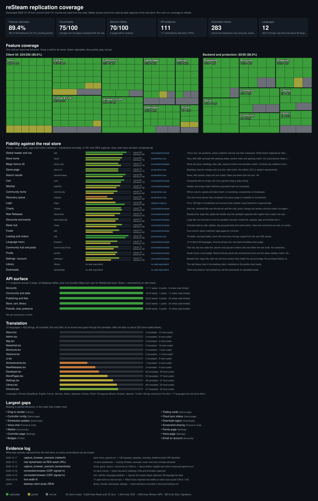

# reSteam replication coverage

Generated 2026-10-18 from commit `76ecefb`. Run `npm run coverage` to refresh.

## Summary

| Measure | Value |
| --- | --- |
| Client behaviors replicated | 214 of 244 (12 partial, 18 not yet) |
| Backend behaviors replicated | 74 of 90 (1 partial, 15 not yet) |
| Visual fidelity (average of compared pages) | 75 / 100 over 16 pages |
| Behavior fidelity | 71 / 100 |
| API endpoints | 98 (98 exercised by e2e checks) |
| Automated checks | 224 |
| Client routes | 21 |
| Database tables | 28 |
| Languages | 12 (249 strings) |

## Fidelity by page

| Page | Route | Method | Visual | Behavior | Verified | Notes |
| --- | --- | --- | --- | --- | --- | --- |
| Global header and nav | `(all)` | connected-browser | 90 | 82 | 2026-10-18 | 104 px bar, nav positions, active underline and top-row links measured. Install button replaced by Upload a game. |
| Store home | `/store` | screenshot+css | 80 | 76 | 2026-10-18 | Hero, 840+360 carousel with peeking slides, section order and spacing match. Art is procedural; fewer shelves. |
| Mega menus (6) | `(store nav)` | connected-browser | 72 | 78 | 2026-10-18 | Panel structure, headings, tiles, pills, expand control and animation match. Contents are reSteam’s own; Hardware has no products. |
| Game page | `/store/:id` | screenshot+css | 72 | 72 | 2026-10-18 | Backdrop, banner, breadcrumb, buy box, rails match. No trailers, DLC or system requirements. |
| Search results | `/store/browse` | screenshot+css | 88 | 82 | 2026-10-18 | Rows, filter panels, chips and sort match; filters are fewer than the real ~40. |
| Cart | `/cart` | connected-browser | 85 | 78 | 2026-10-18 | Compared with an empty cart only; payment step is play money. |
| Wishlist | `/wishlist` | connected-browser | 76 | 68 | 2026-10-18 | Header and empty state matched; populated rows not compared. |
| Community home | `/community` | screenshot+css | 70 | 62 | 2026-10-18 | 940 px column, panels and tabs match; no workshop, screenshots or broadcasts. |
| Discovery queue | `/explore` | screenshot+css | 48 | 60 | 2026-10-18 | Only the home banner was compared; the queue page is modelled on its behavior. |
| Login | `/login` | network-capture | 66 | 86 | 2026-10-17 | Form, QR sign-in handshake and recovery flow studied; visual treatment is approximate. |
| Footer | `(all)` | connected-browser | 74 | 60 | 2026-10-18 | Four-column layout matched; legal pages do not exist. |
| Loading and motion | `(all)` | screenshot+css | 94 | 88 | 2026-10-18 | Throbber, carousel fades, hover lifts and menu timings copied from the real CSS values. |
| Language menu | `(header)` | connected-browser | 70 | 55 | 2026-10-18 | 12 of about 29 languages, chrome strings only; real store translates every page. |
| Community hub and posts | `/community?hub=` | connected-browser | 72 | 62 | 2026-10-18 | Title row, tab row, stats line, banner and popular-content note now follow the real order. No screenshots, artwork, videos or workshop; News and Follow added. |
| Profile | `/profile` | connected-browser | 70 | 66 | 2026-10-18 | Avatar frame, Level badge, Recent Activity panel with achievement bars and the status sidebar match. No badges, inventory or showcases. |
| Settings / account | `/settings/*` | connected-browser | 74 | 56 | 2026-10-18 | Breadcrumb, large title, side nav and blue section bars match the account page. No purchase history, family or payment methods; most panes are reSteam settings. |
| Library | `/library` | no-web-equivalent | - | - | - | The real library lives in the desktop client; modelled on the earlier client study. |
| Downloads | `/downloads` | no-web-equivalent | - | - | - | Client-only feature, here backed by real file downloads for uploaded builds. |

## API endpoints

| Method | Path | Area | Auth | Writes | Tested |
| --- | --- | --- | --- | --- | --- |
| POST | `/auth/register` | Accounts | public | yes | yes |
| POST | `/auth/login` | Accounts | public | yes | yes |
| POST | `/auth/logout` | Accounts | public | - | yes |
| GET | `/auth/me` | Accounts | yes | - | yes |
| POST | `/auth/password` | Accounts | yes | yes | yes |
| POST | `/auth/recover` | Accounts | public | yes | yes |
| DELETE | `/auth/account` | Accounts | yes | yes | yes |
| POST | `/auth/qr/begin` | Accounts | public | yes | yes |
| POST | `/auth/qr/poll` | Accounts | public | yes | yes |
| GET | `/auth/qr/:id` | Accounts | yes | - | yes |
| POST | `/auth/qr/:id/approve` | Accounts | yes | yes | yes |
| GET | `/stats` | Community and stats | public | - | yes |
| GET | `/charts` | Community and stats | public | - | yes |
| GET | `/games/:id/reviews` | Community and stats | public | - | yes |
| PUT | `/games/:id/review` | Community and stats | yes | yes | yes |
| DELETE | `/games/:id/review` | Community and stats | yes | yes | yes |
| POST | `/reviews/:id/vote` | Community and stats | yes | yes | yes |
| POST | `/reviews/:id/report` | Community and stats | yes | yes | yes |
| GET | `/games/:id/posts` | Community and stats | public | - | yes |
| POST | `/games/:id/posts` | Community and stats | yes | yes | yes |
| GET | `/posts/:id` | Community and stats | public | - | yes |
| POST | `/posts/:id/replies` | Community and stats | yes | yes | yes |
| POST | `/posts/:id/vote` | Community and stats | yes | yes | yes |
| DELETE | `/posts/:id` | Community and stats | yes | yes | yes |
| DELETE | `/replies/:id` | Community and stats | yes | yes | yes |
| POST | `/posts/:id/report` | Community and stats | yes | yes | yes |
| POST | `/replies/:id/report` | Community and stats | yes | yes | yes |
| GET | `/community/feed` | Community and stats | public | - | yes |
| GET | `/community/hubs` | Community and stats | public | - | yes |
| GET | `/dev/genres` | Publishing and files | public | - | yes |
| GET | `/dev/games` | Publishing and files | yes | - | yes |
| POST | `/dev/games` | Publishing and files | yes | yes | yes |
| PUT | `/dev/games/:id` | Publishing and files | yes | yes | yes |
| PUT | `/dev/games/:id/cover` | Publishing and files | yes | yes | yes |
| PUT | `/dev/games/:id/shots/:n` | Publishing and files | yes | yes | yes |
| DELETE | `/dev/games/:id/shots` | Publishing and files | yes | yes | yes |
| PUT | `/dev/games/:id/build` | Publishing and files | yes | yes | yes |
| PUT | `/dev/games/:id/web` | Publishing and files | yes | yes | yes |
| DELETE | `/dev/games/:id/build` | Publishing and files | yes | yes | yes |
| DELETE | `/dev/games/:id/web` | Publishing and files | yes | yes | yes |
| PUT | `/dev/games/:id/discount` | Publishing and files | yes | yes | yes |
| GET | `/games/:id/news` | Publishing and files | public | - | yes |
| POST | `/dev/games/:id/news` | Publishing and files | yes | yes | yes |
| DELETE | `/dev/news/:id` | Publishing and files | yes | yes | yes |
| POST | `/dev/games/:id/publish` | Publishing and files | yes | yes | yes |
| POST | `/dev/games/:id/unpublish` | Publishing and files | yes | yes | yes |
| DELETE | `/dev/games/:id` | Publishing and files | yes | yes | yes |
| GET | `/games/:id/cover` | Publishing and files | public | - | yes |
| GET | `/games/:id/shots/:n` | Publishing and files | public | - | yes |
| GET | `/games/:id/download` | Publishing and files | yes | - | yes |
| POST | `/games/:id/play-token` | Publishing and files | yes | yes | yes |
| POST | `/games/:id/report` | Publishing and files | yes | yes | yes |
| GET | `/games` | Store, cart, library | public | - | yes |
| GET | `/me` | Store, cart, library | yes | - | yes |
| PUT | `/cart/:id` | Store, cart, library | yes | yes | yes |
| DELETE | `/cart/:id` | Store, cart, library | yes | yes | yes |
| PUT | `/wishlist/:id` | Store, cart, library | yes | yes | yes |
| DELETE | `/wishlist/:id` | Store, cart, library | yes | yes | yes |
| PUT | `/ignored/:id` | Store, cart, library | yes | yes | yes |
| DELETE | `/ignored/:id` | Store, cart, library | yes | yes | yes |
| PUT | `/followed/:id` | Store, cart, library | yes | yes | yes |
| DELETE | `/followed/:id` | Store, cart, library | yes | yes | yes |
| PUT | `/installed/:id` | Store, cart, library | yes | yes | yes |
| DELETE | `/installed/:id` | Store, cart, library | yes | yes | yes |
| PUT | `/favorites/:id` | Store, cart, library | yes | yes | yes |
| DELETE | `/favorites/:id` | Store, cart, library | yes | yes | yes |
| POST | `/checkout` | Store, cart, library | yes | yes | yes |
| POST | `/wallet` | Store, cart, library | yes | yes | yes |
| POST | `/claim/:id` | Store, cart, library | yes | yes | yes |
| POST | `/redeem` | Store, cart, library | yes | yes | yes |
| POST | `/gift` | Store, cart, library | yes | yes | yes |
| POST | `/playtime/:id` | Store, cart, library | yes | yes | yes |
| PUT | `/profile` | Store, cart, library | yes | yes | yes |
| GET | `/friends` | Friends, chat, presence | yes | - | yes |
| POST | `/friends/requests` | Friends, chat, presence | yes | yes | yes |
| POST | `/friends/requests/:username/accept` | Friends, chat, presence | yes | yes | yes |
| DELETE | `/friends/requests/:username` | Friends, chat, presence | yes | yes | yes |
| DELETE | `/friends/:username` | Friends, chat, presence | yes | yes | yes |
| GET | `/blocks` | Friends, chat, presence | yes | - | yes |
| POST | `/blocks/:username` | Friends, chat, presence | yes | yes | yes |
| DELETE | `/blocks/:username` | Friends, chat, presence | yes | yes | yes |
| GET | `/users/search` | Friends, chat, presence | yes | - | yes |
| GET | `/users/:username` | Friends, chat, presence | yes | - | yes |
| PUT | `/presence` | Friends, chat, presence | yes | yes | yes |
| POST | `/presence/playing` | Friends, chat, presence | yes | yes | yes |
| POST | `/presence/ping` | Friends, chat, presence | yes | - | yes |
| GET | `/chats/:username` | Friends, chat, presence | yes | - | yes |
| POST | `/chats/:username` | Friends, chat, presence | yes | yes | yes |
| POST | `/chats/:username/read` | Friends, chat, presence | yes | - | yes |
| GET | `/groups` | Friends, chat, presence | yes | - | yes |
| POST | `/groups` | Friends, chat, presence | yes | yes | yes |
| GET | `/groups/:id/messages` | Friends, chat, presence | yes | - | yes |
| POST | `/groups/:id/messages` | Friends, chat, presence | yes | yes | yes |
| POST | `/groups/:id/invite` | Friends, chat, presence | yes | yes | yes |
| POST | `/groups/:id/leave` | Friends, chat, presence | yes | yes | yes |
| GET | `/notifications` | Friends, chat, presence | yes | - | yes |
| POST | `/notifications/read` | Friends, chat, presence | yes | yes | yes |
| GET | `/activity` | Friends, chat, presence | yes | - | yes |

## Translation

| Language | Strings | Coverage |
| --- | --- | --- |
| Chinese (Simplified) | 249/249 | 100% |
| English | 249/249 | 100% |
| French | 249/249 | 100% |
| German | 249/249 | 100% |
| Italian | 249/249 | 100% |
| Japanese | 249/249 | 100% |
| Korean | 249/249 | 100% |
| Polish | 249/249 | 100% |
| Portuguese (Brazil) | 249/249 | 100% |
| Russian | 249/249 | 100% |
| Spanish | 249/249 | 100% |
| Turkish | 249/249 | 100% |

## UI text going through the translator

| File | Translated | Hard-coded | Coverage |
| --- | --- | --- | --- |
| About.tsx | 0 | 10 | 0% |
| App.tsx | 0 | 2 | 0% |
| ui.tsx | 0 | 3 | 0% |
| Settings.tsx | 2 | 59 | 3% |
| Developer.tsx | 3 | 37 | 8% |
| Library.tsx | 10 | 56 | 15% |
| Chrome.tsx | 17 | 49 | 26% |
| Community.tsx | 11 | 28 | 28% |
| StorePages.tsx | 31 | 56 | 36% |
| Auth.tsx | 16 | 17 | 48% |
| Profile.tsx | 18 | 5 | 78% |
| Friends.tsx | 37 | 8 | 82% |
| Reviews.tsx | 14 | 3 | 82% |
| StoreGame.tsx | 35 | 7 | 83% |
| Charts.tsx | 2 | 0 | 100% |
| Downloads.tsx | 13 | 0 | 100% |
| Explore.tsx | 6 | 0 | 100% |
| MegaMenu.tsx | 40 | 0 | 100% |
| Player.tsx | 5 | 0 | 100% |

## Features

### Client UI

**Window chrome** (25/26)

- [x] Global header
- [x] Footer
- [x] About page
- [x] Login / join links
- [x] STORE tab
- [x] LIBRARY tab
- [x] COMMUNITY tab
- [x] Profile tab
- [x] Active tab underline
- [x] Notification bell
- [x] Unread count badge
- [x] Notifications popover
- [x] Mark all read
- [x] Account menu
- [x] Balance chip
- [x] Add a Game menu
- [x] Add non-store game
- [x] Activate a product
- [x] Manage Downloads button
- [x] Mini download progress
- [x] Floating Friends & Chat bar
- [x] Toast notifications
- [x] Loading throbber
- [x] Carousel crossfade
- [x] Hover motion
- [ ] Keyboard shortcuts

**Library** (28/32)

- [x] Home button
- [x] Grid view toggle
- [x] Category dropdown
- [x] Recent sort toggle
- [x] Ready-to-play toggle
- [x] Library search
- [x] Favorites section
- [x] Uncategorized section
- [x] Collapsible sections
- [x] Running indicator
- [x] Right-click menu
- [x] Custom collections
- [x] What's New shelf
- [x] Shelf options menu
- [x] Add shelf
- [x] Recent Games shelf
- [x] Time-group labels
- [x] Wide capsule + Time Played
- [x] Shelf scroll arrows
- [x] Download badge on capsule
- [x] Favorites shelf
- [x] Play Next shelf
- [x] Installed shelf
- [x] Friends Activity shelf
- [x] Grid size setting
- [x] Poster grid view
- [x] Rename and delete collections
- [x] Add to collection menu
- [~] Platform filter
- [~] Filter popover
- [~] Game icons in list
- [ ] Drag to reorder

**Game page** (20/26)

- [x] Install split button
- [x] Install options menu
- [x] Play button
- [x] Stop button
- [x] Pause/Resume
- [x] Space required
- [x] Last played
- [x] Play time
- [x] Achievements stat
- [x] Gear menu
- [x] Info dialog
- [x] Favorite heart
- [x] Store Page tab
- [x] Community Hub tab
- [x] Discussions tab
- [x] Guides tab
- [x] Activity post box
- [x] Activity feed
- [x] View Latest News
- [x] Friends who play panel
- [~] Hero art
- [ ] Achievements list
- [ ] Trading cards
- [ ] Controller config
- [ ] Cloud sync status
- [ ] Properties dialog

**Downloads** (16/18)

- [x] Network stat
- [x] Peak stat
- [x] Disk usage stat
- [x] Live bandwidth graph
- [x] Active download panel
- [x] Phase labels
- [x] Progress and ETA
- [x] Up Next queue
- [x] Download next
- [x] Pause and resume
- [x] Remove from queue
- [x] Recently completed
- [x] Settings gear
- [x] Auto-updates label
- [x] Bandwidth limit
- [x] Pause while playing
- [ ] Scheduled updates
- [ ] Download region

**Store** (50/56)

- [x] Browse menu
- [x] Recommendations menu
- [x] Categories menu
- [x] Hardware menu
- [x] Ways to Play menu
- [x] Special Sections menu
- [x] Search with suggestions
- [x] Wishlist link
- [x] Sale hero banner
- [x] Featured carousel
- [x] Carousel info panel
- [x] Send a Gift Card
- [x] Special offers
- [x] Browse by genre
- [x] Top sellers tabs
- [x] Free to play row
- [x] Game page description
- [x] Review summary
- [x] Popular tags
- [x] Buy box
- [x] Follow / Ignore
- [x] Customer reviews
- [x] Write a review
- [x] Helpful votes
- [x] More like this
- [x] Discovery Queue
- [x] Charts and stats
- [x] Account page layout
- [x] Profile layout
- [x] Hub news and follow
- [x] Hover screenshot previews
- [x] Cart page
- [x] Checkout
- [x] Wishlist page
- [x] Free-to-play claim
- [x] Discount badges
- [x] Search results rows
- [x] Narrow-by filter panels
- [x] Sort options
- [x] Active filter chips
- [x] Excluded titles notice
- [x] Ignore hides games
- [x] Follow list
- [x] Payment step
- [x] Cart recommendations
- [x] Discovery queue banner
- [x] Featured tag grids
- [x] Top new releases
- [x] Popular tabs with preview
- [x] Right rail details
- [~] Game page media viewer
- [~] Promo banner
- [~] DLC list
- [~] Handheld compatibility box
- [~] Age rating box
- [~] Platform icons

**Friends & Chat** (28/32)

- [x] Friends window
- [x] Profile header
- [x] Status menu
- [x] Drag hint
- [x] FRIENDS bar
- [x] Friend search
- [x] Add a friend
- [x] Collapsible groups
- [x] A-Z sort
- [x] Friend rows
- [x] Last online text
- [x] Right-click menu
- [x] Profile pages for others
- [x] Chat window
- [x] Typing indicator
- [x] Group chats list
- [x] Create group chat
- [x] Group chat window
- [x] Pending requests
- [x] Remove friend
- [x] Offline messaging
- [x] Unread badges
- [x] Accept / ignore requests
- [x] Block user
- [x] Friend activity feed
- [x] Drag to pin friends
- [x] Favorites strip
- [x] Add to Favorites menu
- [ ] Voice chat
- [ ] Screenshot sharing
- [ ] Emoji and stickers
- [ ] Nicknames

**Community** (25/26)

- [x] Activity page
- [x] Recently played hubs
- [x] Popular hubs
- [x] Find hubs search
- [x] Find people search
- [x] Content tabs
- [x] Most popular / recent
- [x] Content cards
- [x] Review cards
- [x] Hub pages
- [x] Discussions
- [x] Guides
- [x] Hub header and stats
- [x] Hub store banner
- [x] Guide cards
- [x] Post replies and votes
- [x] Real posts and users
- [x] Upload your own game
- [x] Sale pricing
- [x] Game news and follower alerts
- [x] Developer achievements
- [x] Wishlist sale alerts
- [x] UI translation (11 languages)
- [x] Language menu
- [x] Real file downloads
- [ ] Market

**Settings** (16/19)

- [x] Settings window
- [x] Account page
- [x] Add funds
- [x] Privacy settings
- [x] Change password
- [x] Delete account
- [x] Friends & Chat page
- [x] Notifications page
- [x] Interface page + UI scale
- [x] Store page
- [x] Library page
- [x] Downloads page
- [x] Storage page
- [x] In Game page
- [x] Accessibility page
- [x] Security page
- [ ] Family page
- [ ] Controller page
- [ ] Voice page

**Profile** (6/9)

- [x] Profile page
- [x] Public profiles
- [x] Edit display name
- [x] Level badge
- [x] Stats
- [x] Recent activity
- [~] Avatar
- [~] Showcases
- [ ] Badges

### Backend and protection

**Accounts** (10/12)

- [x] Username + password
- [x] PBKDF2 hashing
- [x] Cookie sessions
- [x] Recovery key
- [x] QR sign-in
- [x] Login throttling
- [x] Per-user wallet
- [x] Display name
- [x] Presence status
- [x] Delete account
- [ ] Email on account
- [ ] Two-factor

**Catalog** (5/8)

- [x] Games API
- [x] Tags and publisher
- [x] Live review stats
- [x] Seed from one source
- [x] Upserting migrations
- [ ] Search API
- [ ] Recommendations
- [ ] Developer uploads

**Commerce** (8/11)

- [x] Cart add/remove
- [x] Atomic checkout
- [x] Server-side pricing
- [x] Wishlist
- [x] Add funds (capped)
- [x] Free claim
- [x] Promo codes
- [x] Gift cards
- [ ] Refunds
- [ ] Real payments
- [ ] Regional pricing

**Library** (6/8)

- [x] Ownership
- [x] Install state
- [x] Favorites
- [x] Playtime logging
- [x] Last played
- [x] Achievement unlocks
- [ ] Cloud saves
- [ ] Family sharing

**Social** (14/14)

- [x] Friend requests
- [x] Accept / decline
- [x] Remove friend
- [x] Blocking
- [x] User search
- [x] Profile privacy
- [x] Presence + now playing
- [x] Direct messages
- [x] Real-time push (WebSocket)
- [x] Typing indicator
- [x] Unread counts
- [x] Group chats
- [x] Notifications
- [x] Friend activity feed

**Publishing** (13/16)

- [x] Create a game
- [x] Cover upload
- [x] Screenshot gallery
- [x] Browser-playable builds
- [x] Downloadable builds
- [x] Publish / unpublish
- [x] Edit and delete
- [x] Sandboxed play
- [x] Play tokens
- [x] Owner-only downloads
- [x] Upload limits
- [x] Zip-bomb and path checks
- [x] Cleanup on delete
- [ ] Developer revenue
- [ ] Versioned updates
- [ ] Review before publish

**Community** (8/9)

- [x] Reviews
- [x] Helpful votes
- [x] Discussions
- [x] Guides
- [x] Replies
- [x] Post votes
- [x] Reports
- [x] Hub stats
- [ ] Moderation tools

**Protection** (10/12)

- [x] Per-IP rate limit
- [x] Per-user write limit
- [x] New-user limit
- [x] Body size cap
- [x] Origin check
- [x] Security headers
- [x] CSP
- [x] Bound SQL params
- [x] Generic 500s
- [x] Dependency audit
- [~] Exact (global) limits
- [ ] Abuse monitoring

## Evidence log

| When | Tool | Subject | Result |
| --- | --- | --- | --- |
| 2026-10-17 | capture_browser_scenario (network) | store home, signed out | 138 requests; saledata, userdata, GetItems batch API identified |
| 2026-10-17 | real stylesheets via REA asset URLs | 14 store stylesheets | loading throbber, carousel, hover and menu timings extracted |
| 2026-10-18 | capture_browser_scenario (screenshots) | home, game, search, community at 1400 px | layout widths, heights and colors measured against ours |
| 2026-10-18 | connected browser (CDP, signed in) | six store menus | panel structure, headings, links and animation captured |
| 2026-10-18 | connected browser (CDP, signed in) | cart, wishlist, language pulldown | layouts and empty states captured; 29-language list read |
| 2026-10-18 | font width fit | 17 open fonts vs real nav text | Albert Sans matched real widths at native size (scale 0.99 to 1.00) |
| earlier | desktop client study (REA) | library, friends, downloads, settings | client behaviors recorded in docs/rea-findings.md |
